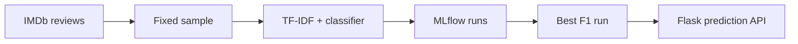

# IMDb Sentiment Classification with MLflow

A small MLOps project I built to compare text classification models on the IMDb movie-review dataset. It samples a fixed training and test subset, tracks accuracy and F1 in MLflow, selects the best run by F1, and serves its text pipeline through a Flask API.

This portfolio edition uses **local** MLflow tracking. It omits the original university CI configuration, run history, saved model binaries, and dataset cache. It contains no precomputed performance claims; run the experiment to see metrics on your machine.

## Pipeline



The classifiers are logistic regression, random forest, and a linear SVM. Each logged model includes **both** the TF-IDF vectorizer and classifier, so serving accepts raw review text. The training sample uses 5,000 reviews and the test sample 1,000 reviews with seed 42. F1 is computed for the positive class. The test set is also used to choose the best model, so its score should not be reported as an unbiased final evaluation; a separate held-out set would be needed for that.

## Run locally

Requires Python 3.11 and internet access for the first IMDb dataset download. From this repository folder in PowerShell:

```powershell
python -m venv .venv
.\.venv\Scripts\Activate.ps1
python -m pip install -r requirements.txt
python train2.py
python select_best.py
```

`train.py` trains a single logistic-regression baseline instead. `train2.py` compares the three models. Both use the local `mlruns/` directory, which Git ignores. Training can take a few minutes.

To inspect the experiments, run `mlflow ui --backend-store-uri ./mlruns --port 5000` and open `http://127.0.0.1:5000`.

## Serve a trained model

Copy the `runs:/.../sentiment_model` value printed by `python select_best.py`:

```powershell
$env:MODEL_URI = "runs:/PASTE_RUN_ID_HERE/sentiment_model"
python serve.py
```

In another PowerShell window, send a test request:

```powershell
Invoke-RestMethod -Uri http://127.0.0.1:5001/predict -Method Post -ContentType 'application/json' -Body '{"texts":["I loved this movie!","The plot was dull."]}'
```

The API returns `0` for negative and `1` for positive predictions. If the selected run is unavailable, train and select again in the same repository folder.

## Repository contents

| File | Purpose |
| --- | --- |
| `train.py` | Logistic-regression baseline |
| `train2.py` | Three-model experiment |
| `select_best.py` | Pick run with highest recorded F1 |
| `serve.py` | Flask prediction endpoint |
| `Dockerfile` | Optional container environment for training |

**Data:** IMDb reviews are obtained at runtime from the [Hugging Face IMDb dataset](https://huggingface.co/datasets/imdb). The repository does not include the reviews, models, or experiment logs.
